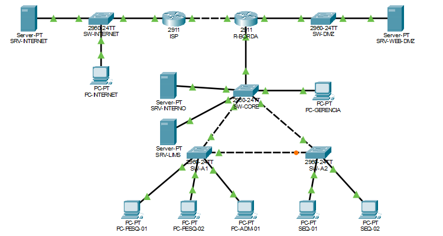
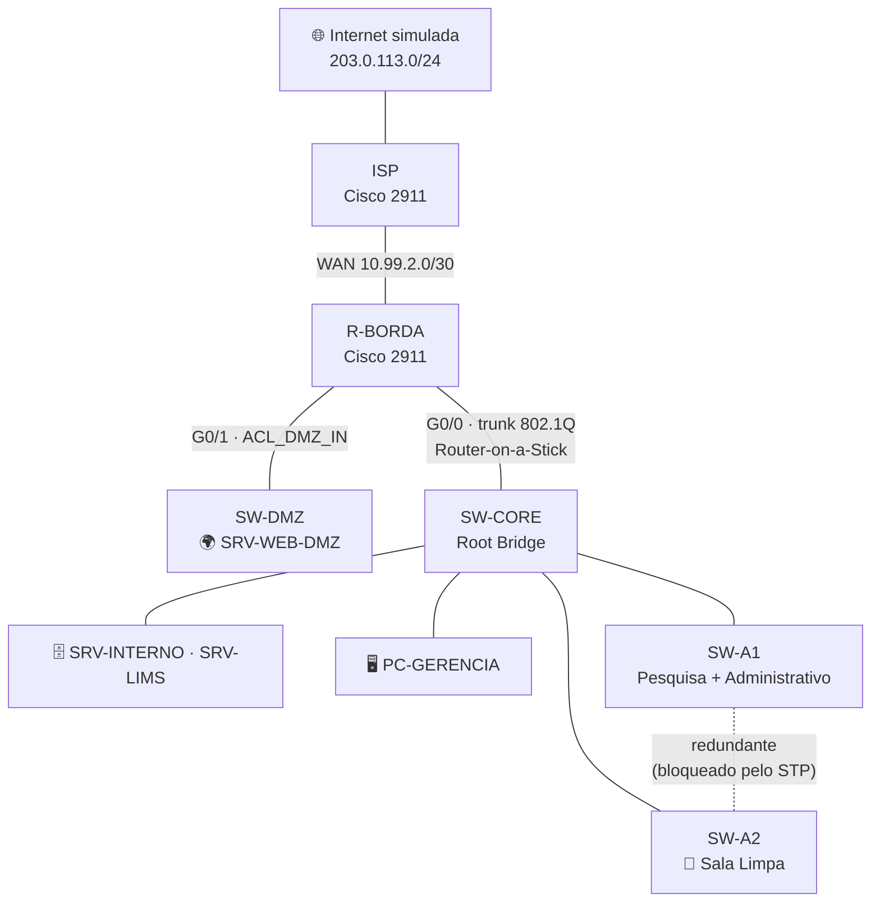

<div align="center">

# 🧬 Laboratório BioGen — Rede Corporativa Segura

**Cenário A10 · Pesquisa Genética & Salas Limpas**

Projeto prático P2 de **Redes de Computadores** — UNIMAR · Análise e Desenvolvimento de Sistemas · 2026/2




</div>

---

## 👥 Grupo 4 — Desafio 10

| | Integrante | Papel |
|:-:|---|---|
| 👑 | **Luiz Costa** | Líder · cenário e decisões de projeto |
| 🔌 | Vinícius Gualtieri | Camadas 1 e 2 · cabos, VLANs e trunk |
| 🌳 | Leonardo Munhoz | STP e Port-Security |
| 🧮 | Gabriel de Lima | VLSM e IPv6 |
| 🛡️ | Matheus Thierry | Router-on-a-Stick e ACLs |
| 🌐 | Artur Taroco | Serviços (DHCP, DNS, Web, FTP) |

---

## 🎯 O desafio

O BioGen é um laboratório de pesquisa genética com salas limpas. A rede precisava atender a três exigências:

| | Exigência | Como resolvemos |
|:-:|---|---|
| 🧪 | **Sequenciadores de DNA com bloqueio de saída** (Zero-Trust outbound) | ACL estendida IPv4 **e** IPv6 na entrada da VLAN 20: os sequenciadores só podem enviar dados ao servidor LIMS (FTP/HTTP) e usar NTP/Syslog |
| 🌍 | **DMZ para divulgação científica** | Site público em uma interface física própria do roteador, acessível pela Internet e impedido de iniciar conexões para a rede interna |
| 📐 | **Bloco 10.99.0.0/21 + IPv6 Dual-Stack** | Sub-redes VLSM do tamanho exato de cada setor e um /64 IPv6 por VLAN. **75% do bloco ficou livre** para crescer |

---

## 🚀 Como abrir

1. Instale o **Cisco Packet Tracer 9.0** ou mais novo.
2. Abra o arquivo **[`BioGen-A10.pkt`](BioGen-A10.pkt)**.
3. Espere os links ficarem 🟢 verdes (ou clique em **⏩ Fast Forward Time**).
4. Para habilitar o SSH, gere a chave no **R-BORDA, SW-CORE, SW-A1 e SW-A2**:
   ```
   enable
   configure terminal
   crypto key generate rsa      ← tamanho: 1024
   end
   copy running-config startup-config
   ```
5. Siga o [roteiro de testes](docs/04-guia-de-estudo-do-grupo.md#12-roteiro-de-testes).

> 🔑 Senha do `enable` e do usuário `admin`: **BioGen@2026** (senha só de laboratório).

---

## 🗺️ Arquitetura



### VLANs e endereçamento

| VLAN | Setor | IPv4 (VLSM) | IPv6 | Hosts |
|:-:|---|---|---|---|
| 10 | Pesquisa | `10.99.0.0/24` | `2001:db8:b10:10::/64` | DHCP + SLAAC |
| 30 | Administrativo | `10.99.1.0/25` | `2001:db8:b10:30::/64` | DHCP + SLAAC |
| 20 | Sequenciadores | `10.99.1.128/26` | `2001:db8:b10:20::/64` | estático |
| 40 | Servidores | `10.99.1.192/27` | `2001:db8:b10:40::/64` | estático |
| 50 | DMZ | `10.99.1.224/28` | `2001:db8:b10:50::/64` | estático |
| 99 | Gerência | `10.99.1.240/28` | `2001:db8:b10:99::/64` | estático |
| — | Link WAN | `10.99.2.0/30` | `2001:db8:b10:ff::/64` | estático |
| — | **Reserva** | `10.99.2.4 – 10.99.7.255` | — | ~1.532 endereços |

VLAN nativa dos trunks: **999** (sem hosts). Portas sem uso: **VLAN 998** e desligadas.

### Segurança

| Regra | Onde | Efeito |
|---|---|---|
| `ACL_SEQ_ZEROTRUST` + `ACL6_SEQ_ZEROTRUST` | R-BORDA G0/0.20 `in` | sequenciadores → apenas LIMS (TCP 20/21/80) e NTP/Syslog |
| `ACL_WAN_IN` | R-BORDA G0/2 `in` | da Internet, só o site da DMZ e as respostas (`established`) |
| `ACL_DMZ_IN` | R-BORDA G0/1 `in` | a DMZ não inicia conexões para a rede interna |
| `access-list 10` | linhas VTY | SSH só a partir da VLAN 99 |
| Port-Security | todas as portas de acesso | sequenciadores: 1 MAC, `shutdown` · usuários: 2 MACs, `restrict` |
| Rapid-PVST+ · PortFast · BPDU Guard | switches | sem loops; porta Gi0/2 do SW-A2 bloqueada |

### Serviços

| Serviço | Servidor | Detalhe |
|---|---|---|
| DHCP | R-BORDA | pools das VLANs 10 e 30, `.1–.10` reservados |
| DNS | SRV-INTERNO `10.99.1.194` | `www.biogen.local`, `lims.biogen.local` |
| HTTP/HTTPS | SRV-WEB-DMZ `10.99.1.226` | site de divulgação científica |
| HTTP + FTP | SRV-LIMS `10.99.1.195` | repositório de dados genômicos |
| NTP + Syslog | SRV-INTERNO | horário e logs centralizados |

---

## 📁 Estrutura do repositório

```
📦 BioGen-Redes-ADS-6-A
├── 🧬 BioGen-A10.pkt                     ← projeto pronto no Packet Tracer
├── 📄 README.md
├── 🎤 apresentacao/
│   └── Apresentacao-BioGen-Grupo4.pptx   ← 4 slides para a apresentação
├── ⚙️ configs/                           ← configuração CLI de cada equipamento
│   ├── R-BORDA.txt · ISP.txt
│   └── SW-CORE.txt · SW-A1.txt · SW-A2.txt · SW-DMZ.txt
├── 📚 docs/
│   ├── 01-plano-de-enderecamento.md      ← VLANs, VLSM, IPv6, cabos, IPs
│   ├── 02-guia-montagem-packet-tracer.md ← montagem passo a passo
│   ├── 03-relatorio-P2.md                ← texto do relatório oficial
│   └── 04-guia-de-estudo-do-grupo.md     ← explicação completa, do zero
└── 🖼️ imagens/
    ├── topologia.png
    └── topologia-completa.png
```

## 📚 Documentação

| Documento | Para quê |
|---|---|
| [📐 Plano de endereçamento](docs/01-plano-de-enderecamento.md) | todas as tabelas de rede |
| [🛠️ Guia de montagem](docs/02-guia-montagem-packet-tracer.md) | remontar a rede do zero e testar |
| [📝 Relatório P2](docs/03-relatorio-P2.md) | conteúdo das 7 seções do modelo oficial |
| [🎓 Guia de estudo](docs/04-guia-de-estudo-do-grupo.md) | entender cada conceito, roteiro de testes e perguntas da banca |

---

## ✅ Testes principais

| Teste | Resultado esperado |
|---|---|
| `SEQ-01 > ping 10.99.1.195` | ❌ *Destination host unreachable* (ICMP bloqueado) |
| `SEQ-01` → navegador `http://10.99.1.195` | ✅ página do LIMS (TCP 80 liberado) |
| `PC-PESQ-01 > nslookup www.biogen.local` | ✅ `10.99.1.226` |
| `PC-PESQ-01` → navegador `http://www.biogen.local` | ✅ site da DMZ |
| `PC-INTERNET > ping 10.99.0.11` | ❌ a Internet não entra na rede interna |
| `SRV-WEB-DMZ > ping 10.99.1.194` | ❌ DMZ isolada |
| `SW-A2# show spanning-tree vlan 20` | Gi0/2 em **Altn BLK** |

---

<div align="center">

**UNIMAR · ADS · Redes de Computadores · Prof. Vinicius Fagundes · 2026/2**

*Grupo 4 — Desafio 10*

</div>
